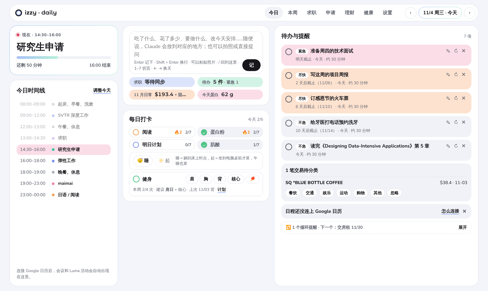
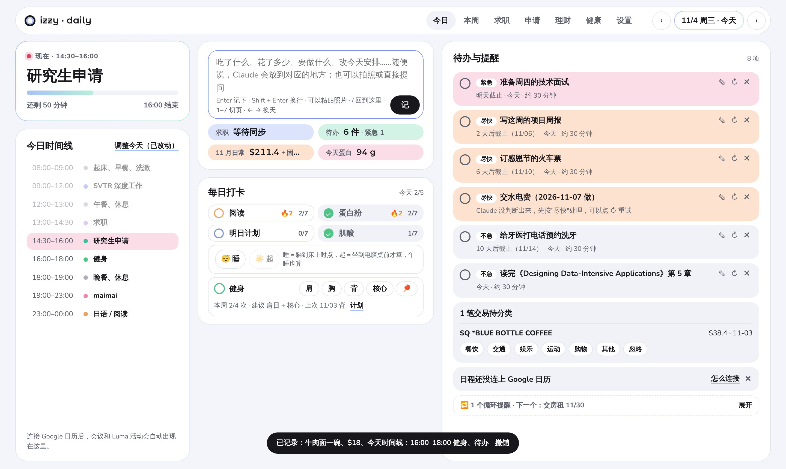
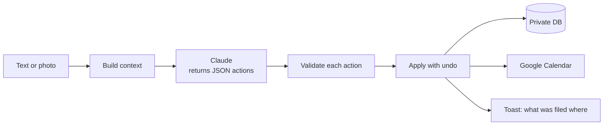
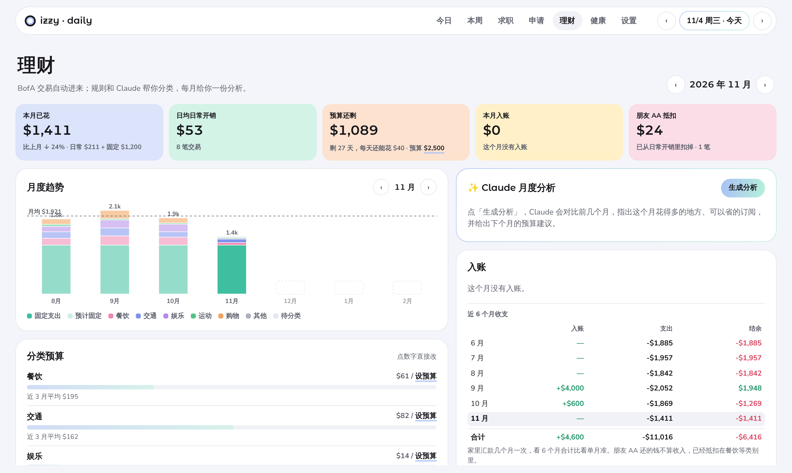

# izzy · daily

**一句话进来，全部归位。** 我的个人每日面板：吃了什么、花了多少、要做什么、今天怎么安排，全都写在同一个输入框里，Claude 判断每件事该放到哪里。 
**One sentence in, everything filed.** My personal daily dashboard. Meals, spending, to-dos and schedule changes all go into one box, and Claude decides where each piece belongs.

> The screenshots use synthetic demo data. My real data lives in a private database and is not in this repo.

---

## The core: one input, one hub

Most personal dashboards make you choose a form first: "log food", "add expense", "new to-do". This one has a single text box (plus a camera button). You type the way you'd text a friend:

> 午饭牛肉面 18，下午 4 点到 6 点去健身，周五前交水电费
> *Beef noodles for lunch, $18. Gym from 4 to 6 this afternoon. Pay the utility bill by Friday.*

One sentence becomes four records, each in the right place:

| What you said | Where it went |
|---|---|
| 牛肉面 (beef noodles) | Food log, with estimated protein and calories |
| 18 | Spending, category "dining" |
| 4 点到 6 点去健身 (gym 4–6pm) | Today's timeline: the gym slot is inserted and the slots it overlaps make room |
| 周五前交水电费 (pay bill by Fri) | To-do, due Friday, prioritized by Claude |

### How the hub works

1. **Build context.** Before calling Claude, the page assembles what it needs to make good decisions: today's date and schedule, open to-dos (with IDs), uncategorized bank transactions, this week's calendar, the job pipeline, and current settings.
2. **Claude proposes.** Claude returns a small JSON list of typed actions, plus a one-line reply. If the sentence is a question ("how much did I spend this month?"), it answers from the data and records nothing.
3. **Code disposes.** Every action passes a validator before anything is written. For example, a to-do update must reference a to-do ID that actually exists, and an event needs a real date and start time.
4. **Apply, then undo.** Additive actions apply immediately with one-tap undo. Deleting anything still asks first.

Supported action types:

| Type | Effect |
|---|---|
| `food` | Food log entry with estimated protein and calories |
| `expense` | Spending record in one of six categories |
| `todo`, `todo_done`, `todo_update`, `todo_delete` | Create, finish, reschedule or remove to-dos |
| `schedule` | Insert or remove time slots on a day's timeline |
| `event` | Write an event to Google Calendar (things involving other people) |
| `check`, `gym`, `sleep`, `sleep_now`, `weight` | Daily habits, workouts, sleep, body weight |
| `txn` | Categorize a pending bank transaction |
| `recurring`, `settings` | Fixed monthly costs, budgets, nutrition goals |
| `job` | Update a job application's status |

### Design rules I learned the hard way

- **Claude returns edits, not rewritten state.** The first version asked Claude to rewrite the whole day's schedule. Once it returned the template unchanged, and the dashboard happily reported "saved". Now Claude only returns the slots to add or remove, and plain code merges them into the timeline. If nothing changed, the toast says so.
- **Never trust "it looked right".** Every write is shown back in plain language ("Today's timeline: 16:00–18:00 gym"), so a wrong guess is visible and one tap undoes it.
- **IDs come from the context, never from the model's imagination.** Actions that touch existing records must use an ID from the list the page provided, or they are dropped.

---

## Everything else

The hub feeds a dashboard with seven pages:

| Page | What's there |
|---|---|
| **Today** | Now card with progress bar, timeline (Google Calendar + weekly template), to-dos ranked by urgency, daily check-ins |
| **Week** | Habit grid, sleep, weekly review drafted by Claude |
| **Jobs** | Application pipeline synced with my job-hunting agent's board, response-odds score |
| **Applications** | Grad school tracker and a copy-paste kit for job forms |
| **Finance** | Spending, income and budgets (see below) |
| **Health** | Sleep log, supplements, workout split |
| **Settings** | Templates, goals, connector status |

### Finance logic

- **Bank alerts in, no bank login.** Transactions come from Bank of America alert emails read through the Gmail connector. They are parsed with regex first and with Claude as a fallback. Gmail message IDs are used as document keys, so re-syncing never duplicates a transaction.
- **Fixed costs count only when actually paid.** Rent and insurance are matched against real payments, not assumed every month.
- **Friends' paybacks are not income.** When a friend pays back their share of dinner, it is stored as a negative amount in "dining", so dining spend reflects what I actually paid.
- **Subscriptions are detected, and dropped when cancelled.** A merchant charging a steady amount for several months is flagged as a subscription. It disappears once a month passes with no charge.
- **Claude handles the long tail.** Merchant rules categorize repeat merchants; Claude categorizes the rest and writes a monthly spending analysis.

### Scheduled agents

Two Claude Code scheduled tasks run outside the page:

- **Morning brief (8:30):** syncs the job board, backfills missed bank transactions, summarizes yesterday's email, and sends me a brief.
- **Job sync:** two-way sync between this dashboard and a separate job-hunting agent's board.

---

## How it's built

- **One HTML file** (`index.html`, ~280 KB, no build step) running as a **Claude Artifact**.
- **Artifact capabilities** (see `artifact.json`):
  - `db`: private document database; the access rules allow only the owner to read or write
  - `sample`: calls Claude from the page (the hub, photo recognition, categorization, analyses)
  - `mcp`: the viewer's own Gmail (read-only) and Google Calendar connectors
  - `user`: identifies the viewer
- **Built with Claude Code** and tested with Playwright against a mocked `window.claude`, at desktop and 390 px phone widths, in light and dark themes.

## Run your own

1. Open Claude Code and connect the Gmail and Google Calendar connectors in claude.ai.
2. Ask Claude to publish `index.html` as an Artifact with the capabilities in `artifact.json`.
3. Open the artifact in claude.ai, allow the connectors, and fill in your own weekly template and application kit in Settings.

The page also opens as a plain file in a browser, but without the Artifact runtime it can't save data or call Claude.

## Privacy

This repo contains code only. My real records (expenses, to-dos, schedule, jobs) live in the artifact's private database, which only I can read. The application kit ships with placeholders, and the screenshots use made-up data.
